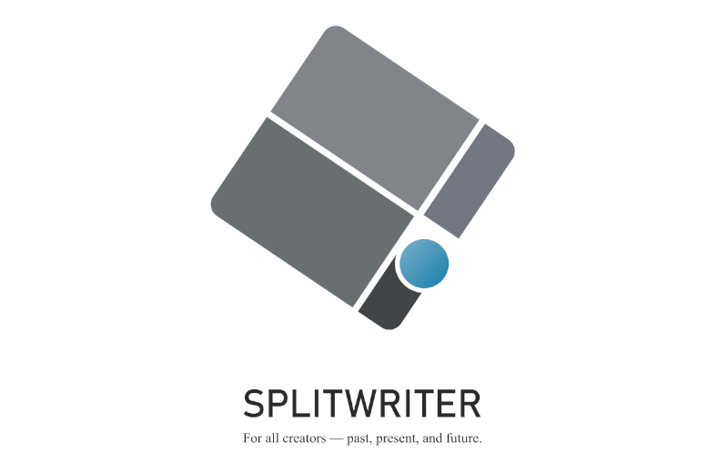

  

<h1 align="center">Splitwriter</h1>

<em>For all creators — past, present, and future.</em>

Splitwriter is a free, offline writing workspace for novels, scripts, journals, and other creative projects. It brings writing and reference materials together in a flexible, distraction-light layout.

## Download — Splitwriter 2.0 Plain

**Current release:** v2.0.0 · Portable · Windows x64

[**Download Splitwriter for Windows x64**](https://github.com/crom-foo/Splitwriter/releases/latest)

- **UI language:** English
- **Typing input:** System IME/keyboard support, with language options including 한국어, 日本語, 中文, Русский, and others
- **Price:** Free for personal and commercial creative work

## The Workspace

Splitwriter was made to help writers spend more time with their stories—not with the tools around them. Write in a TextBoard, keep reference materials close, and arrange your workspace to suit your process.

## What's Included in 2.0

- **Navigator** — Organize boards in Writing and Notes groups. Move boards and groups, and open boards by dragging them into the workspace.
- **Drafts** — Explore different board orders for a manuscript without changing your main Writing arrangement.
- **Manuscript View** — Read the combined text from your Writing boards in order, set spacing between boards, and export as text or PDF.
- **Anchor Board & Anchor Pane** — Keep a designated main working board close at hand.
- **TextBoard** — Write with typeface presets, Typewriter mode, paragraph indentation, writing goals, and Undo/Redo.
- **ImageBoard** — View reference images alongside your writing. Images are referenced by file path rather than embedded in the `.swon` project.
- **Echo View** — Read your writing in an immersive presentation.
- **Flexible workspace** — Split, move, and duplicate boards with their handles.
- **Rolling backups** — Manual saves (Ctrl+S or the Save button) keep up to 10 changed-project snapshots in a `_Backups` folder. Autosave works separately.

## Manual

The Splitwriter 2.0 manual is available in Korean and English:

- [English manual (PDF)](docs/manual/Splitwriter-Manual-v2.0-English.pdf)
- [한국어 매뉴얼 (PDF)](docs/manual/Splitwriter-Manual-v2.0-Korean.pdf)

## Requirements & Getting Started

- **Platform:** Windows x64
- **Recommended OS:** Windows 10 (1803) or later
- **Runtime:** [Microsoft Edge WebView2 Runtime](https://developer.microsoft.com/microsoft-edge/webview2/)

For the portable build:

1. Download the ZIP from [Releases](https://github.com/crom-foo/Splitwriter/releases/latest).
2. Extract it to a folder of your choice.
3. Run `Splitwriter.exe`.

If the app does not start, check that the WebView2 Runtime is installed. This release is unsigned, so Windows SmartScreen may show a warning.

## Project Files & Privacy

Splitwriter uses the `.swon` project format, based on JSON. Writing and project layout are stored locally. Image boards refer to image files by path, so those files may need relinking if moved.

Splitwriter is designed for offline writing without an account or mandatory cloud service.

## License

Splitwriter is released under the **MIT License** and is intended to remain free for personal and commercial creative work.

Created by **Crom Kim & GPT**, 2025–2026.

## Support

Support is optional. Thank you for using Splitwriter.

If it helped you, you can buy me a coffee ☕  
PayPal: [paypal.me/splitwriter](https://paypal.me/splitwriter)
